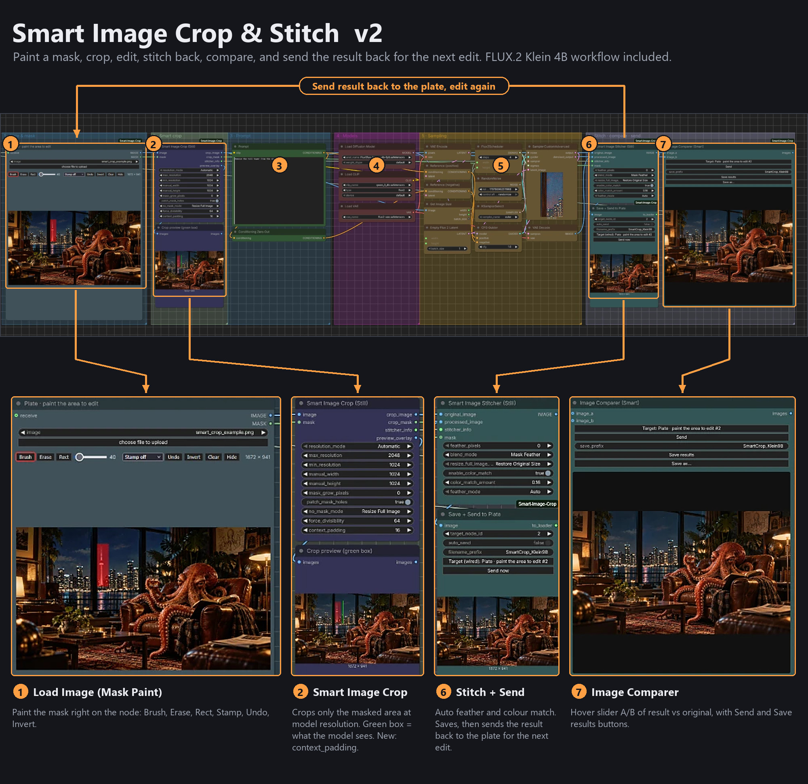
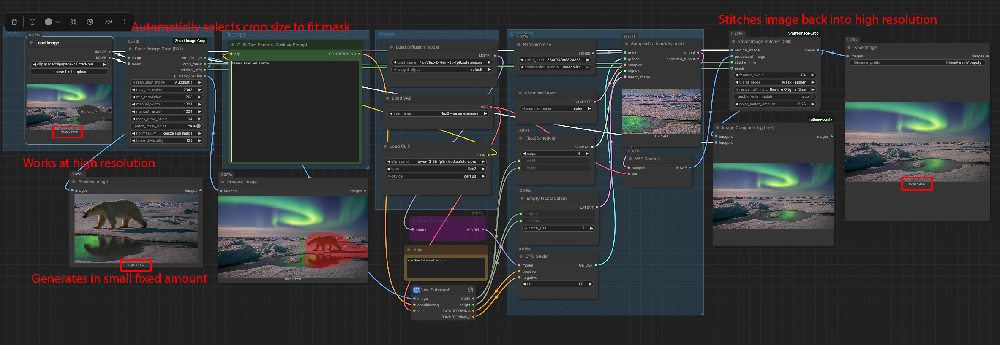

# ComfyUI Smart Image Crop and Stitch

A small ComfyUI custom node pack for smarter inpaint, detail, resize, and edit workflows.

Designed for quick and easy editing on high resolution images.

It finds the active mask area, crops only what needs work, processes the cropped area, then stitches the result back into the original image. If no mask is present, it can either pass through, resize the full image, or use the full image as the crop.

## What's new in v2

Paint the mask on the node, edit, stitch, compare, and send the result back to the plate for the next edit, all in one workflow.



## Nodes

### Send to Load Image

Sends an image back into a Load Image node so you can keep editing the result.

- click `Target` to cycle through the Load Image nodes in the graph
- `auto_send` loads the image into the target every run; otherwise click `Send now`
- files are saved to the output folder with `filename_prefix`, like Save Image
- you can also right-click any node showing an image and choose `Send to Load Image`

### Image Comparer (Smart)

Compares `image_a` and `image_b` with a hover slider (A on the left, B on the right). Without `image_b`, the first two images of `image_a` are compared.

- `Target` picks the Load Image node; `Send` copies image A to `input/smart_sends/` and loads it there
- `Save results` copies image A to the output folder as `<save_prefix>_<date-time>.png`, keeping the workflow metadata

### Smart Image Crop

Creates a clean crop from an image and mask.

Main features:

- detects even very light grey masks
- turns detected mask pixels into a solid mask
- optional fast hole filling
- grow or shrink the mask with positive or negative pixels
- automatic or manual output size
- dimensions snap to model-friendly values like `1024`, `1280`, etc.
- preview overlay with mask tint and crop border
- no-mask modes: `Bypass`, `Resize Full Image`, `Crop Full Image`

Outputs:

- `crop_image`
- `crop_mask`
- `stitcher_info`
- `preview_overlay`

### Smart Image Stitcher

Places the processed crop back into the original image.

Main features:

- blend modes: `Box Feather`, `Mask Feather`, `Hard Paste`
- optional color match, off by default
- can restore full-image resize results back to original size
- can also keep the resized processed image as the final output
- automatic bypass when the crop node is bypassed

## Screenshot



## Install

Clone into your ComfyUI custom nodes folder:

```powershell
cd ComfyUI/custom_nodes
git clone https://github.com/HallettVisual/ComfyUI-Smart-Image-Crop-and-Stitch.git
```

Restart ComfyUI. The nodes appear under:

```text
Smart Image Tools
```

The repo also includes ComfyUI Registry metadata for ComfyUI Manager discovery once it is listed by the registry.

### ComfyUI Manager

This repo is ready for Comfy Registry publishing. After it is published there, users can find and install it through ComfyUI Manager.

Registry package id:

```text
smart-image-crop-and-stitch
```

## Basic Workflow

1. Send your source `IMAGE` and `MASK` into `Smart Image Crop`.
2. Process `crop_image` and `crop_mask` with your inpaint, detail, upscale, or edit workflow.
3. Send the processed image into `Smart Image Stitcher`.
4. Connect the original image and `stitcher_info`.
5. Use the stitcher output as your final image.

## Useful Settings

- `mask_grow_pixels`: positive values grow the mask, negative values shrink it.
- `patch_mask_holes`: fills enclosed holes in the mask.
- `context_padding`: extra pixels around the mask bounds for scene context and stitch feather room. Use at least `feather_pixels`.
- `max_megapixels`: the largest crop sent to the model. Lower it if you run out of VRAM: try `1.0`-`1.5` on 8 GB cards. `0` means no limit.
- `force_divisibility`: keeps crop sizes friendly for models and VAEs.
- `blend_mode`: choose box feather, mask feather, or hard paste.
- `feather_mode`: `Auto` sizes the soft edge to the crop (small faces get a light edge, large regions a wide blend). `Pixels` uses `feather_pixels`.
- `enable_color_match`: optional color correction against the original image.
- `no_mask_mode`: choose what happens when no mask exists.
- `resize_full_image_output`: for no-mask resize workflows, choose original size or resized output.

## Notes

- If `feather_pixels` is `0`, feathered modes behave like a hard paste.
- `Resize Full Image` is useful when one workflow should handle both masked edits and full-image resize/upscale jobs.
- Existing workflows may need nodes refreshed or re-added after input changes.

## The included workflow

`workflows/Smart Crop & Stitch - FLUX.2 Klein 4B.json`: paint a mask, prompt, run. The result is stitched back, compared, and can be sent back to the plate for the next edit.

Models:

- `models/diffusion_models/` [flux-2-klein-4b-fp8.safetensors](https://huggingface.co/black-forest-labs/FLUX.2-klein-4b-fp8/resolve/main/flux-2-klein-4b-fp8.safetensors)
- `models/text_encoders/` [qwen_3_4b.safetensors](https://huggingface.co/Comfy-Org/z_image_turbo/resolve/main/split_files/text_encoders/qwen_3_4b.safetensors)
- `models/vae/` [flux2-vae.safetensors](https://huggingface.co/Comfy-Org/flux2-dev/resolve/main/split_files/vae/flux2-vae.safetensors)

1. Copy the contents of `workflows/input/` into your `ComfyUI/input/` folder.
2. Restart ComfyUI and load the workflow. The example edit, removing the CN Tower, runs as-is.

ComfyUI refuses to run a workflow that points at an image it cannot find, so do step 1 first, or pick an image of your own once it's loaded.

## More workflows

The Smart Crop & Stitch Workflow Pack has a tuned workflow for each of FLUX.2 Klein 9B and 4B, FLUX 3 Klein, Qwen Image 2.1 with a cropped reference image, and MOSS-Image Edit:

**[hallett-ai.com](https://hallett-ai.com)**

## License

Apache License 2.0. See [LICENSE](LICENSE).
